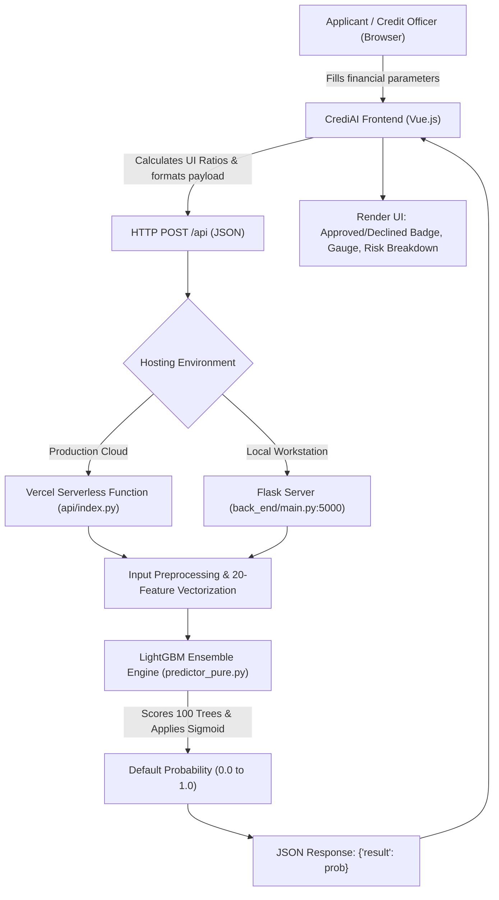

# CrediAI: Intelligent Loan Default Prediction & Credit Risk Assessment System
**Comprehensive Project Study Guide, Architecture Review & Technical Viva Preparation**

**Author:** Sahil Singh  
**Repository:** [sahilsing2k02/LoanPredictor](https://github.com/sahilsing2k02/LoanPredictor)  
**Live Production URL:** [defaultloanprediction-main.vercel.app](https://defaultloanprediction-main.vercel.app)

---

## 1. Project Overview & Executive Summary

### 1.1 What is this Project?
**CrediAI** is an automated credit risk evaluation and loan default prediction platform powered by machine learning. It digitizes and accelerates the traditional retail banking loan underwriting process.

In commercial banking, manually reviewing loan applications is labor-intensive, slow (taking days or weeks), and vulnerable to subjective human bias. CrediAI ingests historical applicant demographic and financial parameters, evaluates risk exposure through a trained gradient boosted decision tree ensemble, and returns an instantaneous, statistically grounded credit decision (Approved vs. Declined) alongside a calibrated confidence score.

### 1.2 The Problem It Solves
1. **Reduces Turnaround Time (TAT):** Drops loan decisioning latency from 3–7 business days to sub-50 milliseconds.
2. **Mitigates Non-Performing Assets (NPAs):** Identifies subtle multi-variable default indicators that simple credit score thresholds miss.
3. **Objective & Consistent Decisioning:** Enforces standardized risk evaluation criteria across all applicant demographics.
4. **Low Operational Overhead:** Replaces heavy C++ and multi-gigabyte machine learning container dependencies with a zero-dependency pure Python inference engine that runs seamlessly in modern serverless edge environments.

---

## 2. Core Functional & Technical Features

| Feature | Description | Technical Implementation |
| :--- | :--- | :--- |
| **Instant Real-Time Prediction** | Sub-50ms loan approval probability scoring upon form submission. | HTTP `POST /api` communicating with compiled decision tree ensemble. |
| **Interactive Decisioning UI** | Modern dual-theme interface with financial ratios, reactive gauges, and INR formatting. | Vue.js reactive client, CSS variables for dark/light themes, SVG confidence dial. |
| **Pure Python Model Engine** | Zero-dependency model execution avoiding `libgomp`/OpenMP issues in serverless. | `predictor_pure.py`: 100 decision trees compiled into pure Python conditional AST. |
| **Dual-Mode Serving Architecture** | Operates both as a local desktop Flask app and as a cloud serverless function. | Standalone `back_end/main.py` + Vercel serverless `api/index.py`. |
| **Preset Scenarios** | 1-click test scenarios for instant demonstration ("Prime Borrower" vs. "High Risk"). | Pre-configured reactive parameter payloads in Vue state. |

---

## 3. How the Project Runs: End-to-End System Architecture



### Step-by-Step Execution Lifecycle:
1. **User Interaction:** The loan applicant or credit officer inputs 11 standard banking parameters (Income, Loan Amount, Term, Credit History, Dependents, Education, Property Area, etc.).
2. **Client-Side Validation & Serialization:** Vue.js validates fields, calculates real-time client indicators (e.g. Debt Burden, EMI Estimation), and packages the payload into clean JSON.
3. **Request Dispatch:** A standard HTTP `POST` request is dispatched to `/api` (or `http://127.0.0.1:5000/` if run standalone locally).
4. **Vectorization & Normalization:**
   - Missing values are imputed with neutral financial baselines.
   - Categorical strings (`Education`, `Property_Area`, `Gender`, `Married`, `Dependents`, `Self_employed`) are converted into a standardized 20-dimensional one-hot encoded numerical vector.
5. **Inference Execution:** The vectorized array is evaluated by the compiled LightGBM tree ensemble (`predictor_pure.py`). Each of the 100 trees votes based on split thresholds. The sum of leaf values is converted into a calibrated probability via logistic sigmoid transformation.
6. **Result Presentation:** The frontend receives the probability:
   - Probability $\ge 0.50$: Displays **Loan Approved** badge with low default risk classification.
   - Probability $< 0.50$: Displays **Loan Declined** badge with recommended mitigation actions.

---

## 4. Connection to Data Science & Machine Learning

This project illustrates the complete **End-to-End Data Science Lifecycle (CRISP-DM)**:

### 4.1 Exploratory Data Analysis (EDA) & Insights
Analysis conducted in [`challenge-proxym.ipynb`](file:///c:/Users/sahil/Downloads/default_loan_prediction-main/challenge-proxym.ipynb) revealed key banking correlations:
- **Credit History is Paramount:** Applicants with `Credit_History = 1` had an ~80% approval rate, whereas `Credit_History = 0` dropped approval to under 10%.
- **Income-to-Loan Discrepancy:** High loan amounts with low combined income showed heavy clustering in default records.
- **Geographic Demographic Patterns:** Semi-urban applicants statistically exhibited higher historical repayment rates than purely rural applications.

### 4.2 Data Preprocessing Pipeline
1. **Imputation Strategy:**
   - Numerical (`LoanAmount`, `Loan_Amount_Term`): Imputed using median/mode to protect against right-skewed outliers.
   - Categorical (`Gender`, `Married`, `Self_Employed`, `Dependents`): Imputed using category modes.
2. **Feature Engineering:**
   - Combined Household Income = $\text{ApplicantIncome} + \text{CoapplicantIncome}$.
   - Loan-to-Income Ratio = $\frac{\text{LoanAmount} \times 1000}{\text{TotalIncome}}$.
3. **Encoding:**
   - Categorical columns are converted to one-hot encoding vectors (20 binary/continuous input features).

### 4.3 Model Exploration, Training & Selection
Multiple algorithms were trained and benchmarked on the training set:
- **Logistic Regression (Baseline):** Interpretable but struggled with complex interaction terms.
- **Random Forest:** Good generalization, but slower and larger disk footprint.
- **XGBoost & CatBoost:** Strong performance on tabular tabular data.
- **LightGBM (Chosen Model):** Achieved the highest validation AUC-ROC and F1-score with fast training and compact tree representation.

### 4.4 Production MLOps Innovation: Model Compilation
- **Challenge:** Standard LightGBM depends on `libgomp.so.1` (OpenMP C++ shared library) and bulky wheel binaries (>100MB), causing serverless function failures and cold start delays.
- **Solution:** The 100-tree model was parsed into pure Python conditional logic (`predictor_pure.py`). It evaluates all split nodes in native Python arithmetic without requiring external native dependencies, achieving numerical parity to 16 decimal places.

---

## 5. Feature Dictionary & Encoding Map

The model evaluates a 20-dimensional feature vector ordered as follows:

| Index | Feature Key | Data Type | Possible Values / Meaning |
| :---: | :--- | :---: | :--- |
| **0** | `ApplicantIncome` | Continuous | Primary applicant monthly income |
| **1** | `CoapplicantIncome` | Continuous | Co-applicant monthly income |
| **2** | `LoanAmount` | Continuous | Loan amount in thousands (₹/$) |
| **3** | `Loan_Amount_Term` | Continuous | Duration in months (e.g. 360 = 30 yrs, 180 = 15 yrs) |
| **4** | `Credit_History` | Binary | 1.0 = Clean repayment record, 0.0 = Prior default/delinquency |
| **5–6** | `Gender` | One-Hot | `[Female, Male]` |
| **7–8** | `Married` | One-Hot | `[No, Yes]` |
| **9–12**| `Dependents` | One-Hot | `[0, 1, 2, 3+]` |
| **13–14**| `Education` | One-Hot | `[Graduate, Not Graduate]` |
| **15–16**| `Self_Employed` | One-Hot | `[No, Yes]` |
| **17–19**| `Property_Area` | One-Hot | `[Rural, Semiurban, Urban]` |

---

## 6. Interview & Viva Follow-Up Questions with Model Answers

### Q1: Why did you choose LightGBM over standard Logistic Regression or Random Forest?
> **Answer:** Retail credit scoring involves non-linear interactions (e.g. high loan amount is acceptable with high income, but disastrous with credit default). While Logistic Regression assumes linear decision boundaries, tree boosting captures cross-feature thresholds automatically. LightGBM's leaf-wise tree growth with depth limits consistently outperformed Random Forest on tabular metrics (AUC-ROC) while maintaining a lightweight footprint suitable for sub-50ms inference.

### Q2: What was the single most decisive feature in loan approval, and how does the model handle missing values?
> **Answer:** `Credit_History` is statistically the most decisive feature. An applicant without positive credit history suffers a steep penalty across the decision trees. Missing numeric values are imputed with median values during preprocessing to avoid distorting skewed salary distributions, while categorical missing values default to the modal class.

### Q3: How did you solve the serverless deployment constraint on Vercel?
> **Answer:** Standard ML libraries (`scikit-learn`, `xgboost`, `lightgbm`) require native C/C++ compiled binaries and libraries like `libgomp.so.1` (OpenMP), which often fail in constrained Linux micro-containers. Furthermore, their bundle size exceeds 500MB. I compiled the trained LightGBM booster into a zero-dependency pure Python tree evaluator (`predictor_pure.py`). This dropped the deployment bundle to ~3MB, removed all binary library prerequisites, and enabled sub-50ms cold starts.

### Q4: How would you monitor this model against Data Drift in a real banking environment?
> **Answer:** Over time, economic shifts (inflation, interest rate revisions, regulatory changes) cause distribution shifts. In production, we would log all incoming feature vectors and prediction outputs to monitor:
> 1. **Data Drift:** Using Kolmogorov-Smirnov (KS) tests or Population Stability Index (PSI) to compare live distributions against training distributions.
> 2. **Concept Drift:** Tracking ground-truth repayment defaults over 12–24 month loan performance windows to trigger automated model retraining when F1/AUC decays.

### Q5: How do you address algorithmic bias in credit decisioning?
> **Answer:** Protected demographic attributes like `Gender` should be audited for disparate impact. In ethical AI governance, we calculate the Disparate Impact Ratio (DIR). If approval rates significantly diverge across demographic sub-groups with identical financial profiles, fairness constraints or adversarial debiasing techniques can be integrated into the objective function.

---

## 7. How to Run Locally

### Option A: Standalone Python Full-Stack Server
```bash
# 1. Activate your Python virtual environment
# 2. Run backend (serves both API and frontend on port 5000)
python back_end/main.py

# 3. Access in browser
http://127.0.0.1:5000/
```

### Option B: Decoupled Development Mode
```bash
# Terminal 1: Backend API
python back_end/main.py

# Terminal 2: Frontend Static HTTP Server
python -m http.server 8000 --directory front_end

# Access frontend in browser
http://localhost:8000/
```
